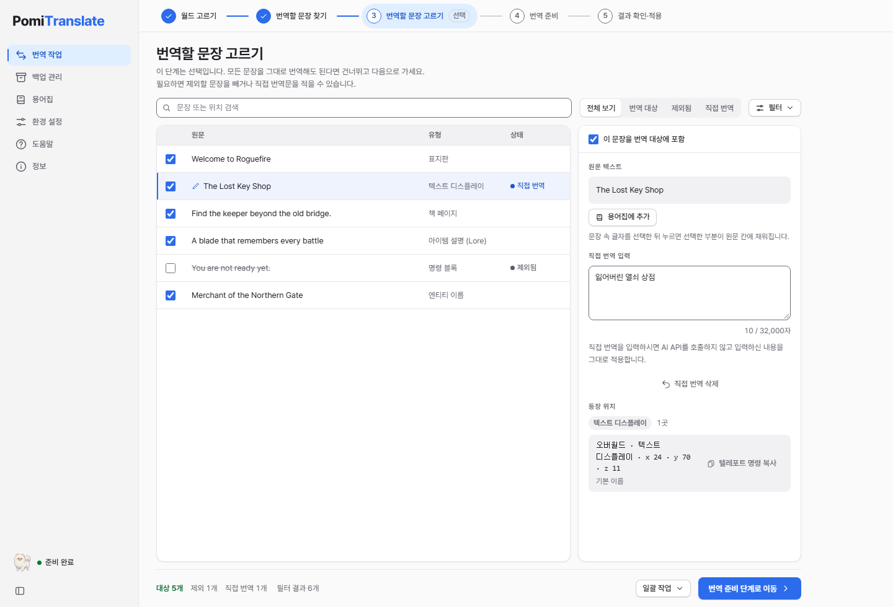
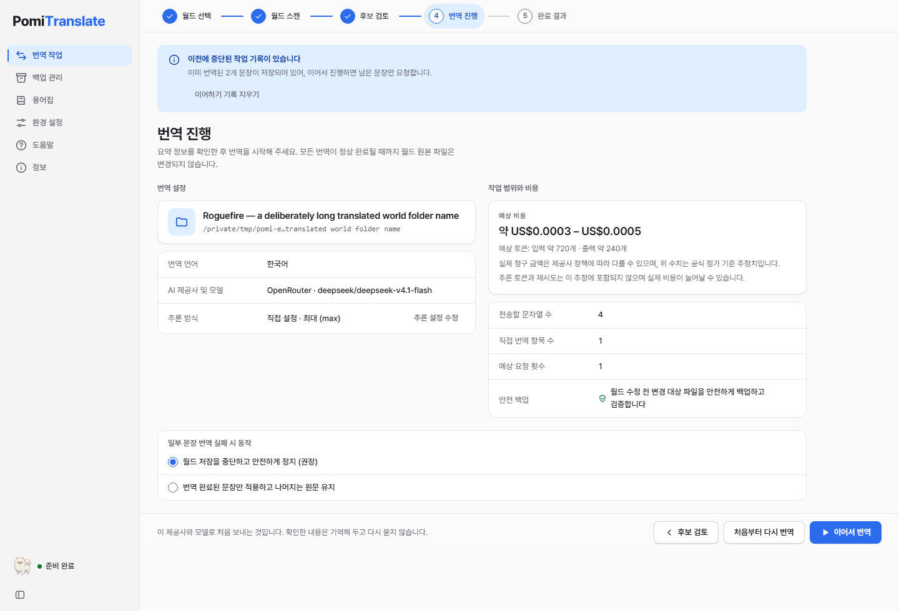

# PomiTranslate 사용 안내

[English](user-guide.en.md) | 한국어 | [日本語](user-guide.ja.md) | [简体中文](user-guide.zh.md)

## 시작 전


현재는 개발 중인 앱입니다. macOS Apple Silicon의 개발 앱에서 주요 흐름을 확인했지만 정식 서명 배포·전체 OS 검증은 완료되지 않았습니다. [실행 준비](development.md)와 [지원 범위](support-matrix.md)를 먼저 확인하세요.

Minecraft나 서버를 종료하고 월드의 **독립된 복사본**을 만드세요. 자동 백업은 별도 백업을 대체하지 않습니다. 원본 맵·리소스팩의 권한은 그대로 원작자에게 있으며 MIT 소프트웨어 라이선스가 맵 재배포 권한을 부여하지 않습니다.

## 1. 환경 설정

환경 설정은 두 부분으로 나뉩니다. **번역** 탭(제공사·키·모델·언어·범위·성능, 설정 파일 가져오기·내보내기)은 바꾼 뒤 저장해야 적용되며, 하단 저장 영역도 이 탭에서만 나타납니다. **앱** 탭(화면 모드·표시 언어·알림·업데이트·데이터·진단·초기화)은 바꾸는 즉시 적용되고 저장 버튼이 없습니다. 저장하지 않은 번역 설정이 있는 채로 앱 탭으로 옮기면 저장·저장 안 함·계속 편집을 먼저 묻습니다. 탭은 방향키(←→, Home, End)로도 옮길 수 있습니다.

### 제공사·모델·키


- **제공사:** OpenAI, Gemini, Anthropic, OpenRouter, Comet, Custom endpoint 중에서 고릅니다. Custom은 endpoint URL과 wire format(OpenAI/Anthropic 호환)을 함께 지정합니다.
- **모델:** 모델 ID를 직접 입력하거나 목록에서 고릅니다. 단가 정보가 있으면 100만 토큰당 입력·출력 가격을 보여 줍니다.
- **모델 정보 조회:** OpenRouter는 공개 catalog를 자동으로 조회하고 수동 새로고침도 제공합니다. 이 조회는 설정을 저장하지 않으며 키와 월드 텍스트를 보내지 않습니다. 다른 제공사는 저장된 키가 필요할 수 있습니다. 캐시·조회 실패·모델 미발견은 화면에 구분해 표시합니다.
- **API 키:** AI 번역에 쓸 본인의 키를 입력해 저장합니다. 저장된 키는 값 대신 저장 여부와 방식만 보여 주며, 변경·삭제할 수 있습니다.
- **추론(OpenRouter·Gemini):** 모델 기본값, 추론 끄기, 직접 설정 중에서 고릅니다. 모델 정보가 확인된 경우 지원 강도만 표시하고, 필수 추론 모델에서는 끄기를 선택할 수 없습니다. Gemini는 저장된 키로 **모델 목록 불러오기**를 한 번 해야 모델의 thinking 지원 여부가 확인됩니다. Gemini 3 계열의 thinking은 기본으로 켜져 있어 짧은 번역에도 많은 사고 토큰(출력으로 과금)을 쓸 수 있으므로, 번역에는 **추론 끄기**를 권장합니다. 일부 최신 모델(3.7/3.8 flash, pro, `gemini-flash-latest`)은 완전히 끌 수 없어 앱이 그 모델이 허용하는 가장 낮은 단계로 자동 조정합니다. 사고 토큰은 결과 화면의 출력 토큰에 포함해 표시합니다.
- **사용량 확인(OpenRouter):** 저장된 키의 누적 사용 크레딧을 조회합니다. 번역 요청을 보내거나 설정을 저장하지 않으며, 같은 키의 다른 작업과 집계 지연 때문에 전후 차이가 이 작업의 비용과 정확히 같지는 않을 수 있습니다.

### 번역 언어·문체

- **도착 언어:** 번역 결과의 언어를 직접 입력합니다(예: 한국어, English, 日本語). UI 언어(ko/en/ja)와는 별개입니다.
- **문체:** 표준/자연스러움(권장), 친근함/대화체, 격식체/명료함, 정중한 존댓말, 소설/이야기풍, 사용자 지정 시스템 프롬프트 중에서 고릅니다.
- **추가 지시:** "고유명사는 원문 유지"처럼 원하는 규칙을 덧붙입니다.
- **지시문 다듬기:** 짧은 메모를 AI로 확장하는 기능입니다. 선택한 제공사에 별도 요청을 보내며 비용이 발생할 수 있으므로 확인 후 실행하세요.

### 스캔 범위

- **월드 텍스트 종류:** 표지판, 책 페이지, 책 제목, 필터링된 책 제목, 엔티티·블록 이름, 아이템 이름, 아이템 설명, 텍스트 디스플레이, 명령 텍스트 컴포넌트 중에서 검사할 종류를 고릅니다. 추천 범위와 스토리 중심 preset, 모두 선택/해제를 제공하며, 명령어처럼 보이는 일반 문자열을 제외할 수도 있습니다.
- **이미 번역 언어로 작성된 텍스트 건너뛰기:** 재번역 비용과 시간을 줄입니다.
- **파일 및 번역 키 규칙:** 추가 리전 폴더, 제외할 파일 패턴, 번역 키 접두사를 지정합니다.
- **ZIP 리소스팩:** 월드 내부 `resources.zip`과 직접 선택한 외부 ZIP(최대 16개)을 함께 번역할지 정합니다. 범위가 바뀌면 다시 스캔해야 합니다.

### 속도·요청 한도

- 동시 요청 수, 요청당 묶음 문장 수, 분당 요청(RPM)·토큰(TPM) 한도, 요청 제한 시간, 최대 재시도 횟수, 생성 다양성(Temperature)을 조절합니다. 0으로 두면 별도 속도 제한을 두지 않습니다.
- 파일 쓰기 시도 횟수와 "파일 오류 시 다른 파일을 계속 처리" 여부를 정합니다. 계속 처리하면 결과가 부분 완료로 표시됩니다.

### 고급 설정과 저장

- **저장형 수동 번역:** 모든 월드에 적용할 원문→번역문 JSON을 등록합니다. API를 호출하지 않으며 후보 검토에서 입력한 번역이 우선합니다. 최대 5,000개, 각 32,000자, 전체 1 MB입니다.
- **가져오기·내보내기:** PomiTranslate·기존 웹 UI의 JSON 또는 `translate.py`를 가져옵니다. Python 파일은 실행하지 않고 공개 문자열 상수만 읽습니다. API 키·월드 경로·UI 언어·외부 ZIP 경로는 가져오지 않습니다.
- **하단 저장 영역(번역 탭):** 변경됨/저장됨 상태를 확인하고 저장하거나 변경을 취소합니다. 가져오기·내보내기는 공개 설정용이며 키를 포함하지 않습니다.

### 앱 인터페이스와 정보

- **화면 표시 언어:** 한국어·영어·일본어 중에서 고릅니다. 번역 도착 언어와는 별개입니다.
- **화면 모드:** 환경 설정 → 애플리케이션 인터페이스의 미리보기 타일(시스템·라이트·다크)이나 메뉴 막대의 보기 → 화면 모드에서 고릅니다. 고르는 즉시 화면·창 테두리·메뉴 체크 표시에 적용되며 저장 버튼 없이 설정 파일에 남습니다. **시스템**은 운영체제의 라이트/다크 설정을 따르고, 앱을 켜 둔 채 운영체제 설정을 바꿔도 바로 따라갑니다. 저장된 모드로 시작하도록 배경 처리를 구현했습니다. 최신 macOS/Windows 네이티브 창의 시작 깜빡임·색 검증은 아직 남아 있습니다.
- **확대:** 보기 메뉴에서 75–200%까지 확대할 수 있습니다. `Cmd/Ctrl+0`은 100%, `Cmd/Ctrl+2`는 200%입니다.
- **메뉴·단축키:** 파일 → 월드 열기(`Cmd/Ctrl+O`), 설정(`Cmd+,` macOS 앱 메뉴 / Windows·Linux는 파일 메뉴), 편집 → 찾기(`Cmd/Ctrl+F`, 후보 검토 화면의 검색창으로 이동), 도움말 → 도움말·시작 안내·단축키·오픈소스 라이선스·문제 신고(업데이트 확인은 macOS 앱 메뉴, 그 외 도움말 메뉴). 웹 링크는 앱 창이 아닌 기본 브라우저에서 열립니다.
- **창:** 긴 스캔·번역 중에는 Dock(macOS)·작업 표시줄(Windows)에 진행률이 표시되고, 창이 뒤에 있을 때 작업이 끝나면 아이콘으로 알립니다. 작업 중에는 창 닫기와 앱 종료(`Cmd+Q`)를 막고 이유를 알려 줍니다.
- **정보 화면:** 버전, 검증된 형식과 미지원 형식, 시스템 진단 정보, 저장소·라이선스·문의 링크, Minecraft 비공식 고지 원문을 확인할 수 있습니다. **오픈소스 라이선스**에서 앱에 포함된 구성 요소의 라이선스 전문을 볼 수 있습니다(도움말 메뉴에서도 열림).
- **도움말·시작 안내:** 사이드바의 도움말(또는 `F1`, macOS `Cmd+?`)에서 빠른 시작, 자주 묻는 질문, 단축키, API 키 발급 페이지, 문제 신고를 볼 수 있습니다. 처음 실행하면 안내 동의 후 4단계 시작 안내가 한 번 나오며, 도움말 메뉴 → 시작 안내로 다시 볼 수 있습니다.
- **업데이트:** 환경 설정 → 업데이트에서 새 버전을 확인합니다. 하루 한 번 자동 확인(끌 수 있음)은 GitHub에서 최신 버전 정보만 받아 옵니다. 서명 검증 키가 들어간 배포본은 앱 안에서 설치 후 다시 시작하고, 그렇지 않은 빌드는 다운로드 페이지를 엽니다. 스캔·번역·복원 중에는 설치하지 않습니다. 업데이트 후 설정·저장된 키·백업을 유지하도록 설계했으며, 실제 서명 업데이트의 설치·데이터 보존 검증은 아직 남아 있습니다. 저장하지 않은 설정이 있으면 다시 시작하기 전에 저장·저장 안 함·취소를 먼저 묻습니다.
- **데이터 보관 위치:** 환경 설정에서 설정·작업·백업 폴더와 암호화된 키 폴더의 경로를 보고 열 수 있습니다. 앱 업데이트나 캐시 정리 도구는 이 폴더를 지우지 않습니다. 자세한 내용은 [업데이트·데이터 보존](updates-and-data.md).
- **초기화:** 환경 설정 → 초기화는 두 번 확인한 뒤 모든 설정, 최근 월드, 이어서 할 작업, 모델 목록(선택하면 저장된 API 키까지)을 지우고 앱을 다시 시작합니다. **월드 백업과 원본 월드는 지우지 않습니다.** 키체인처럼 확인하지 못한 단계가 있으면 나머지를 진행하지 않고 무엇이 남았는지 보여 주며 다시 시도할 수 있습니다. 계속 확인되지 않는 항목은 운영체제 키체인에서 PomiTranslate 항목을 직접 삭제해 주세요.

## 2. 월드 선택과 스캔


복사본의 월드 폴더(level.dat 포함)나 서버 루트 폴더를 선택합니다. **월드 폴더 열기**, 창에 폴더(또는 `level.dat`)를 끌어다 놓기, 또는 **Minecraft 월드** 목록에서 고르는 세 가지 방법이 있습니다. 목록은 공식 런처와 Prism/MultiMC(macOS·Linux), CurseForge(Windows)의 saves 폴더를 읽기만 해서 월드 아이콘·이름·마지막 플레이 시각을 보여 줍니다. 앱은 월드를 안으로 복사하지 않고 직접 읽습니다. 원본 월드 대신 복사본을 고르세요. 화면에서 차원 구성, 데이터 형식(DataVersion), 월드 내장 리소스팩, 보존 중인 백업 수를 확인합니다.

Bedrock, 구형 `.mcr`, `.linear`, 게임·서버가 사용 중인 월드, 읽기·쓰기 권한이 없는 폴더, 월드 밖을 가리키는 경로는 시작 전에 차단됩니다.

월드 화면의 **스캔 시작**은 바로 스캔을 시작합니다. **월드 스캔**은 번역 API 호출·월드 파일 수정 없이 후보를 수집합니다. 결과에서 고유 문자열 수와 등장 위치 수를 구분해 읽고, 스캔 대상과 제외 목록도 확인하세요. 읽을 수 없는 청크는 원본 그대로 유지되며 경고로 표시됩니다. 모르는 포맷·압축·읽기 오류를 지원 완료로 간주하지 않습니다. 명령 블록의 `tellraw`/`title`은 기존 JSON 형식과 Java 1.21.5부터의 SNBT 형식(`{text:'Hello',color:gold}`)을 모두 읽으며, 바뀐 문자열만 원래 따옴표 형식대로 다시 씁니다. 형식을 해석할 수 없는 명령은 원본 그대로 두고 "형식을 해석할 수 없는 명령 N개" 경고로 알립니다. 스캔 화면의 **최신 스캔 보고서 내보내기**로 결과를 JSON 파일로 저장할 수 있습니다.

## 3. 후보 검토



검색(문장 또는 위치), 정렬(월드 순서·원문순·빈도순·유형별), 텍스트 유형·상태 필터로 문장을 찾습니다. 항목을 선택하면 원문과 등장 위치를 확인하고 직접 번역문을 입력할 수 있습니다. 포함을 해제하면 해당 후보를 번역에서 제외합니다. 현재 필터에 해당하는 항목을 일괄 포함/제외할 수도 있습니다.

`§` 서식 코드와 `%s`, `{0}` 같은 자리표시자는 게임 안에서 그대로 표시되도록 유지하세요. AI 번역문에서 필수 기호가 빠지거나 원문에 없던 기호가 추가되면(예: 색 코드를 하나 더 넣어 다른 단어의 색이 바뀜) 해당 문장은 원문을 유지하고 결과에 "서식 보호로 원문 유지"로 표시합니다. 코드가 같은 개수로 다른 단어 옆으로 옮겨진 번역은 허용합니다.

현재 후보는 같은 원문을 여러 등장 위치에 적용하는 단위입니다. 위치별 번역 분리와 translation memory는 후속 작업입니다. 용어는 아래 "용어집"에서 정합니다. 모든 문장을 직접 번역하면 AI 번역 API 요청 없이 적용할 수 있습니다.

## 용어집

사이드바의 "용어집"에서 고유명사와 용어를 늘 같은 말로 번역하거나(`이렇게 번역`), 번역하지 않고 그대로 두도록(`그대로 두기`) 정해 둡니다. 예를 들어 "Elder Mira"를 그대로 두면 번역문에서도 Elder Mira로 남습니다.

- **범위:** "모든 월드"는 모든 월드에 적용되고, "이 월드"는 선택한 월드에만 적용됩니다. 같은 원문이 둘 다 있으면 이 월드의 항목이 우선합니다.
- **항목:** 원문, 처리 방법, 번역, 대소문자 구분, 메모. 항목은 2,000개까지, 원문과 번역은 각각 200자까지 넣을 수 있습니다. 변경은 "저장"을 눌러야 적용되며, 저장하지 않은 채 다른 화면으로 가거나 앱을 닫으면 확인을 묻습니다.
- **다른 곳에서 바뀐 경우:** 저장하려는 사이에 용어집이 바뀌었다면 입력한 내용을 그대로 둔 채 "저장된 버전 불러오기"(내 변경은 사라짐) 또는 "내 변경 유지"를 고를 수 있습니다.
- **가져오기·내보내기:** CSV/TSV 파일(첫 줄 `source,target,mode,note,caseSensitive`)을 "합치기" 또는 "통째로 바꾸기"로 가져옵니다. 결과에는 추가·수정·그대로·삭제 수와, 건너뛴 줄과 그 이유가 표시됩니다. 내보내기는 앱에서 저장 창으로 파일 위치를 고르고(저장하지 못하면 클립보드 복사를 제안), 브라우저에서는 파일로 내려받습니다. `=`·`+`·`-`·`@`로 시작하는 칸은 스프레드시트가 수식으로 읽지 않도록 앞에 `'`를 붙이며, 다시 가져오면 원래대로 돌아옵니다.
- **후보 검토에서 추가:** 후보를 선택하고 "용어집에 추가"를 누르면 선택한 글자(없으면 문장 전체)가 원문에 채워집니다.
- **결과 확인:** 번역이 용어집과 다르게 나왔거나(용어집 불일치) 서식 코드 뒤에 원문 글자가 남은 경우, 실행·결과 화면에 건수와 예시(최대 5개)를 보여 줍니다. 용어집을 바꾸면 이어하기 전에 저장된 번역 일부를 버리고 다시 번역합니다.

## 4. 실행과 결과



**번역 진행**에서 대상 월드, 언어, 제공사·모델, 전송할 문자열 수, 직접 번역 항목 수, 예상 요청 횟수, 예상 비용, 안전 백업 여부를 확인합니다. 추정은 청구 상한이 아닙니다. 추론 토큰·재시도·계정/라우팅 차이와 제공사 집계 지연을 고려해 실제 대시보드도 확인하세요. 직접 번역 항목만 적용하는 모드에서는 API 요청이 발생하지 않습니다.

실행 중 취소를 요청하면 협력적으로 중단하며 checkpoint를 사용해 남은 번역을 이어갈 수 있습니다. 취소·실패가 항상 파일 변경0을 뜻하지 않으므로 완료 결과의 변경 수·오류·사용량을 확인합니다. 이미 기록한 파일이 있으면 백업 복원을 검토하세요. 재개 설정이나 파일 지문이 달라지면 재스캔이 필요할 수 있습니다.

결과 화면은 다음 상태를 구분해 보여 줍니다.

| 상태 | 의미 |
| --- | --- |
| 완료 | 모든 번역을 적용했습니다. |
| 일부 완료 | 번역하지 못한 문장은 원문 그대로 유지했습니다. |
| 재시도 필요 | 월드 파일은 변경되지 않았고, 이미 번역된 문장은 저장되어 남은 문장만 이어서 번역할 수 있습니다. |
| 실패 | 변경 파일 수와 오류를 확인하고 필요하면 백업을 복원합니다. |
| 취소됨 | 이미 번역된 문장은 저장되어 언제든 이어서 진행할 수 있습니다. |
| 월드 사용 중 | 게임·서버를 종료한 뒤 다시 시도합니다. |
| 월드가 바뀜 | 스캔 이후 파일이 변경되어 쓰기를 중단했습니다. 다시 스캔합니다. |
| 미지원 형식 | 월드 파일은 전혀 변경되지 않았습니다. |

결과의 첫 숫자는 상태에 따라 "적용한 번역문"(월드에 씀)·"일부 적용된 번역문"·"준비만 된 번역문"(월드에 쓰지 않음)으로 이름이 바뀝니다. 결과에는 번역 완료·원문 유지(고유명사 등)·번역 실패·서식 보호로 원문 유지 문장 수, 변경된 파일 수, API 요청 수, 사용 토큰이 표시되고, 제공사가 비용을 알려 준 경우에만 보고된 비용이 함께 표시됩니다. 최종 청구액은 제공사 대시보드에서 확인하세요. 번역 예시, 실패 문장 목록과 서식 보호로 원문을 유지한 문장도 확인할 수 있습니다.

게임에서 내용과 명령 동작을 직접 확인하세요. 번역문은 부정확할 수 있습니다. **최신 번역 보고서 내보내기**로 결과를 JSON 파일로 저장할 수 있으며, 보고서에는 월드 경로와 원문·번역문이 포함될 수 있으므로 공유 전에 확인하세요.

## 5. 복원

Minecraft와 서버를 종료한 상태에서 **백업 관리**를 엽니다. 월드와 복원 시점을 확인하고 복원 안내를 읽은 뒤 실행합니다. 복원 직전 현재 파일을 보관하는 recovery snapshot이 생성됩니다. 복원은 해당 파일의 백업 이후 편집·게임 진행을 되돌릴 수 있습니다.

백업은 번역 전 자동 백업과 복원 직전 안전 스냅샷으로 구분되며, 앱 데이터 보관소와 (구버전) 월드 폴더 내부에 있을 수 있습니다. 무결성 검증 여부가 표시됩니다. 외부 ZIP을 함께 번역했다면 복원 시 설정에서 같은 ZIP을 다시 선택해야 합니다.

Desktop은 자동 백업과 checkpoint 위치를 앱이 관리하며 백업 끄기·접미사·임의 경로 옵션은 제공하지 않습니다. 번역으로 새 대형 청크 파일이 생성된 경우에도 복원 전 현재 상태를 보관하고 번역 전 파일 구성으로 되돌립니다. 이 새 백업은 최신 앱으로 복원하세요. 기존 Legacy 백업은 계속 발견·복원할 수 있습니다.

검증되지 않은 백업·경로 오류·손상 경고를 무시하지 마세요. 백업은 모든 저장장치 고장이나 외부 수정에서 복구를 보장하지 않습니다.

## CLI

CLI는 같은 Python 코어를 사용하며 데스크톱 vault와 credential 경로가 다릅니다. 기존 CLI의 keyring/환경변수 호환을 유지합니다. 비밀을 명령 인자·평문 설정·Git에 기록하지 말고 기존 OS keyring을 사용하세요. 데스크톱에 키를 저장했다고 CLI에서 자동 공유되는 것은 아닙니다.

```bash
# --report-path는 월드 밖의 임시 경로로 지정합니다.
.venv/bin/python mc_world_translator.py \
  --world-dir "/path/to/World-copy" \
  --dry-run \
  --report-path "/tmp/pomi-scan-report.json"

.venv/bin/python mc_world_translator.py --help
```

주요 옵션:

| 옵션 | 설명 |
| --- | --- |
| `--dry-run` | 스캔만 수행하고 API 호출·파일 쓰기를 하지 않습니다. |
| `--expect-fingerprint` | 스캔 보고서의 지문과 월드가 다르면 쓰기를 거부합니다. |
| `--resume` | 저장된 checkpoint에서 남은 번역을 이어갑니다. |
| `--restore-backup` | 검증된 최신 백업으로 복원합니다. |
| `--no-backup` | 백업 없이 실행합니다. 권장하지 않습니다. |
| `--resource-pack-zip` | 번역할 ZIP 리소스팩 경로입니다. 여러 번 지정할 수 있습니다. |
| `--enable-resource-pack-translation` / `--disable-resource-pack-translation` | 설정과 무관하게 ZIP 번역을 켜거나 끕니다. |
| `--list-models` | 선택한 제공사의 모델 목록을 출력하고 종료합니다. |
| `--enhance-style-brief` | 짧은 문체 메모를 AI로 확장합니다. 별도 비용이 발생할 수 있습니다. |
| `--print-notices` | 첫 실행 안전 안내를 출력합니다. |
| `--provider`, `--model`, `--base-url`, `--wire-format`, `--api-key` | 제공사·모델·endpoint·키를 지정합니다. |
| `--target-language`, `--style-preset`, `--style-prompt`, `--custom-system-prompt` | 번역 언어와 문체를 지정합니다. |
| `--batch-size`, `--temperature` | 요청 묶음 크기와 생성 다양성을 지정합니다. |
| `--config`, `--data-dir`, `--report-path` | 설정 파일, 데이터 폴더, 보고서 경로를 지정합니다. |

macOS/Linux 예시이며 Windows에서는 `.venv\Scripts\python.exe`를 사용합니다. 실제 실행은 파일 수정과 API 청구를 발생시킬 수 있습니다.

## 문제 해결


| 증상 | 확인할 것 |
| --- | --- |
| 앱을 준비하지 못했습니다 | 코어 시작은30초, 최근 월드·백업 초기 정보는60초 안에 응답하지 않으면 중단됩니다. **다시 시도**를 누르고 반복되면 앱 재시작·최근 월드 저장 장치 연결을 확인하세요. 실행 중인 긴 번역·복원에 적용되는 제한은 아닙니다. |
| `AUTH_FAILED` | 환경 설정에서 API 키를 다시 확인합니다. |
| `NO_CREDIT` | 제공사 계정의 잔액·크레딧을 확인합니다. |
| `RATE_LIMITED` | 잠시 후 다시 시도하거나 동시 요청 수를 낮춥니다. |
| `MODEL_NOT_FOUND` | 모델 ID를 확인하거나 **모델 목록 불러오기**로 다시 조회합니다. Gemini의 예전 별칭 `flash`/`pro`는 이제 `gemini-flash-latest`/`gemini-pro-latest`로 바뀝니다. |
| Gemini 응답이 느리거나 "output token limit" 오류 | thinking이 켜진 모델입니다. 환경 설정에서 추론을 끄거나 `flash-lite` 계열을 고르세요. |
| `NETWORK_ERROR` | 인터넷 연결과 제공사 상태를 확인합니다. |
| 월드 사용 중 | Minecraft·서버를 완전히 종료한 뒤 다시 시도합니다. |
| 스캔 결과가 오래됨 | 월드나 설정이 바뀌면 다시 스캔합니다. |
| 저장된 키 상태를 확인할 수 없음 | 키를 새로 입력하거나 삭제한 뒤 다시 저장합니다. |

문제가 있으면 [Issues](https://github.com/kim0040/PomiTranslate/issues)에 OS·버전·비밀을 제거한 재현 절차를 남겨 주세요. [면책 안내](disclaimer.md) · [데이터 안내](privacy.md)
